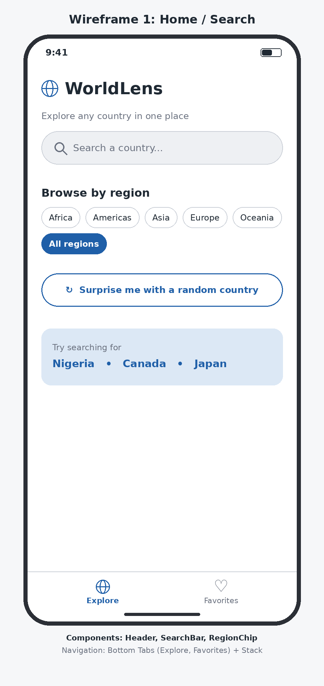
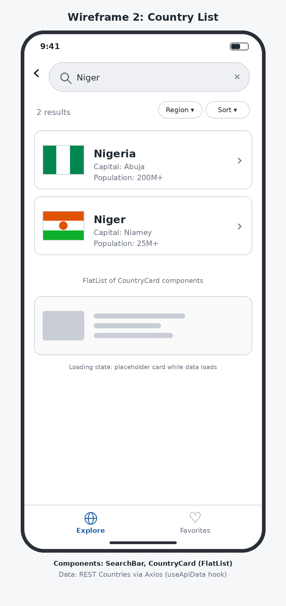
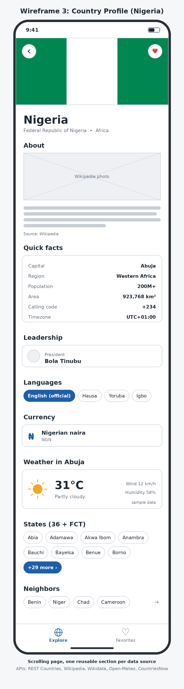
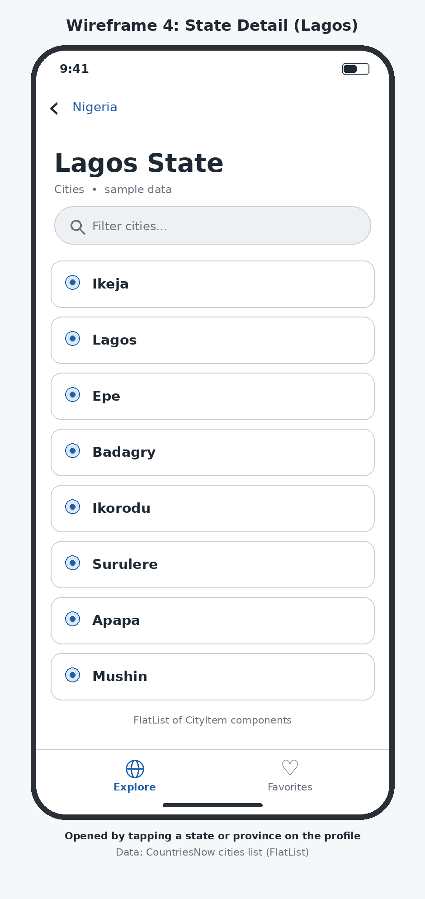

# WorldLens

A React Native (Expo) app that works like a pocket encyclopedia for countries. Search any country and get one complete profile: description, key facts, leaders, languages, currency, current weather in the capital, and its states or provinces with their cities.

> Status: Phase 1 (proposal). This README will be updated as the app is built.

**Team:** The Swaggers (Abdulquadri Kuku, Yaa Adarkwa, Marc Kellyanne)

## Project Overview

WorldLens fetches live data from public APIs using Axios and async/await. It does not use a local database or hardcoded country data.

**Target users:** students, travelers, and anyone curious about the world.

**Example:** search "Nigeria" to see Abuja as the capital, the naira as the currency, the president, the official and widely spoken languages, the current weather, and the 36 states plus the Federal Capital Territory. Tap a state to see its cities.

## Features

- Search countries by name and filter by region
- Results list with flag, capital, and population
- Country profile: About, Quick Facts, Leadership, Languages, Currency, Weather, States or Provinces, Neighbors
- State or province detail with a list of cities
- Favorites
- Loading spinners, error messages with retry, and empty states

## Screens

1. Home / Search
2. Country List
3. Country Profile
4. State or Province Detail
5. Favorites

## Tech Stack

- React Native with Expo
- React Navigation (Bottom Tabs + Stack)
- Axios
- React Hooks (`useState`, `useEffect`, `useReducer`) and custom hooks (`useApiData`, `useCountryProfile`, `useFavorites`)
- FlatList
- Expo Vector Icons (Ionicons, MaterialIcons)

## APIs Used

| Data | API |
|---|---|
| Country facts | REST Countries (https://restcountries.com) |
| Weather | Open-Meteo (https://open-meteo.com) |
| Description and photo | Wikipedia REST API |
| Leaders, extra languages | Wikidata |
| States, provinces, cities | CountriesNow (https://countriesnow.space) |
| Exchange rate (optional) | Frankfurter or open.er-api.com |

None of these APIs require an API key.

## Setup

Prerequisites: Node.js (LTS), npm, and the Expo Go app on your phone or an emulator.

```bash
# 1. Clone the repository
git clone https://github.com/quadrikuku20-cpu/WorldLens.git
cd WorldLens

# 2. Install dependencies
npm install

# 3. Start the app
npx expo start
```

Then scan the QR code with Expo Go, or press `a` (Android emulator) or `i` (iOS simulator).

If you are starting the project from scratch, these are the main packages:

```bash
npx create-expo-app WorldLens
cd WorldLens
npx expo install react-native-screens react-native-safe-area-context
npm install axios @react-navigation/native @react-navigation/native-stack @react-navigation/bottom-tabs
npm install @expo/vector-icons
```

## Folder Structure

```
WorldLens/
  App.js
  src/
    components/     reusable UI (SearchBar, CountryCard, InfoRow, ...)
    screens/        Home, CountryList, CountryProfile, StateDetail, Favorites
    hooks/          useApiData, useCountryProfile, useFavorites
    services/       Axios API functions
    navigation/     tab and stack navigators
    context/        favorites reducer
    utils/
  assets/
  docs/             proposal and wireframes
  README.md
```

## Team and Contributions

| Member | Responsibilities |
|---|---|
| Abdulquadri Kuku | Project setup, navigation, Home and Country List screens, GitHub management |
| Yaa Adarkwa | API services, custom hooks, Country Profile data logic |
| Marc Kellyanne | Reusable components, styling and responsive layout, Favorites screen, wireframes, README |

## Development Timeline

| Week | Milestone |
|---|---|
| 1 | Proposal, wireframes, GitHub repo, project setup |
| 2 | Navigation, Home screen, SearchBar, Country List |
| 3 | Country Profile with Wikipedia, Open-Meteo, and currency data |
| 4 | Leadership (Wikidata), States and cities, Favorites, neighbor navigation |
| 5 | Styling, responsive layout, loading and error states, testing |
| 6 | Cleanup, README, screenshots, video presentation |

## Proposal

- [Phase 1 proposal (PDF)](docs/WorldLens_Proposal.pdf), which opens right here on GitHub
- [Phase 1 proposal (Word)](docs/WorldLens_Proposal.docx), which needs to be downloaded

## Wireframes

| Home / Search | Country List |
|---|---|
|  |  |

| Country Profile (Nigeria) | State Detail (Lagos) |
|---|---|
|  |  |

## Screenshots

App screenshots will be added here once the screens are built.

## License

For educational use as part of a course project.
